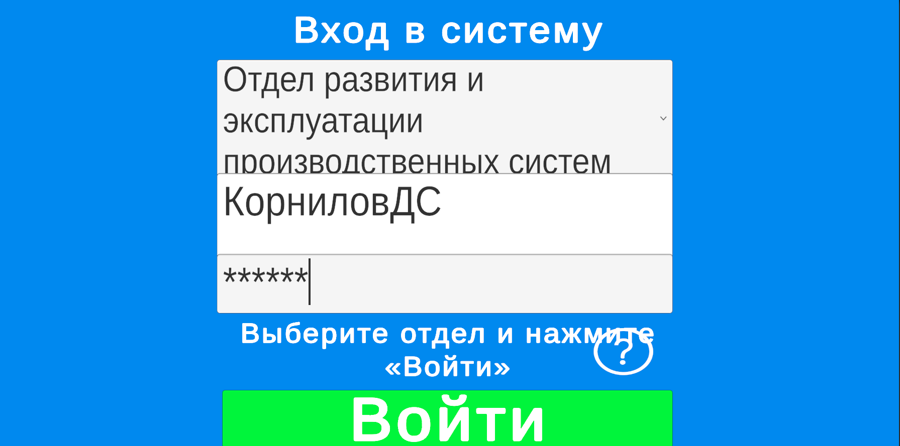
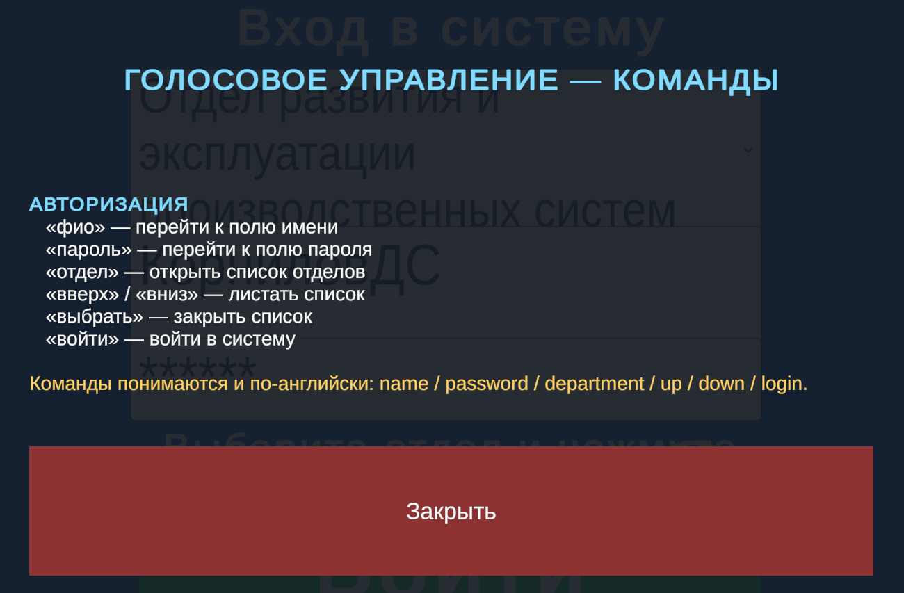
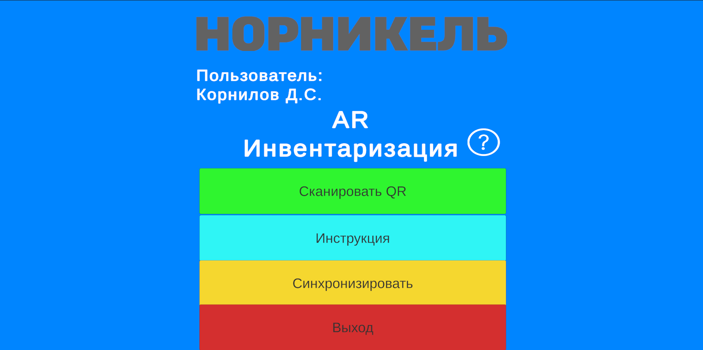
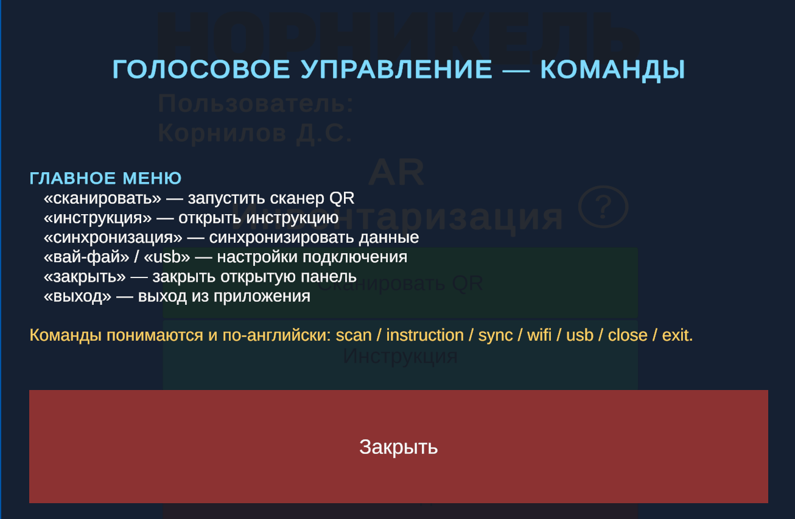
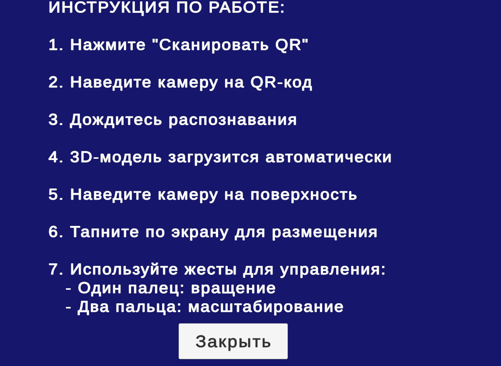
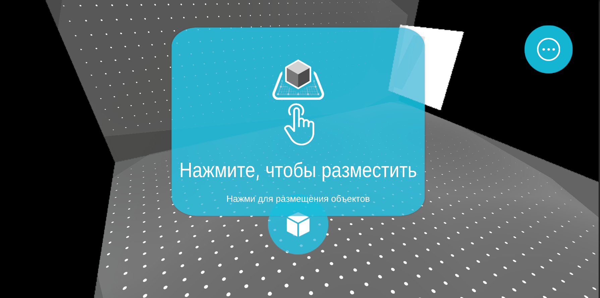
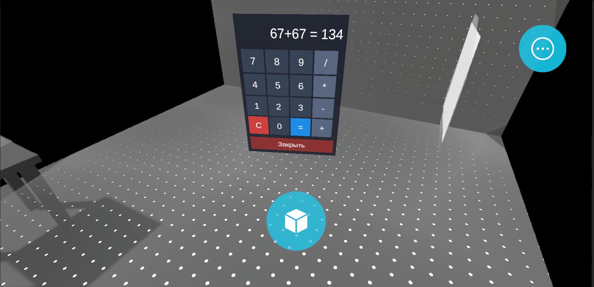
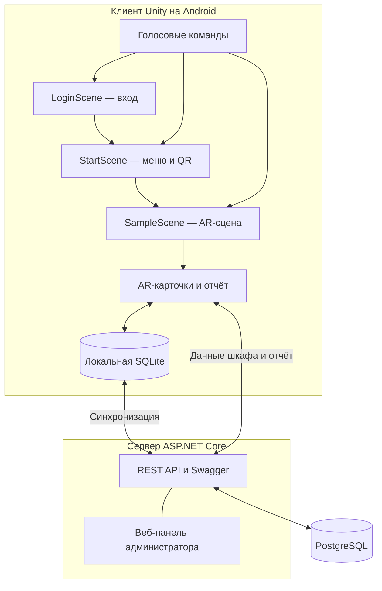

# AR Инвентаризация · КГМК

> Мобильное AR-приложение: авторизация сотрудников, QR-сканирование шкафов, интерактивные панели дополненной реальности, голосовое управление, офлайн-режим и синхронизация с сервером.

<p>
  
  
  
  
  
</p>

## Содержание
1. [О проекте](#1-о-проекте)
2. [Ключевые возможности](#2-ключевые-возможности)
3. [Экраны приложения](#3-экраны-приложения)
4. [Архитектура](#4-архитектура)
5. [Технологический стек](#5-технологический-стек)
6. [Структура репозитория](#6-структура-репозитория)
7. [Сервер и данные](#7-сервер-и-данные)
8. [Быстрый старт](#8-быстрый-старт)

---

## 1. О проекте

Приложение разработано для проведения инвентаризации шкафов на предприятии. Сотрудник входит в систему, сканирует QR-код шкафа и открывает в дополненной реальности нужные панели: изображение шкафа, чек-лист предметов и калькулятор. После проверки можно сохранить фотографии сцены, записать голосовой комментарий и отправить отчёт администратору.

Приложение использует локальную базу SQLite для справочников и работы без сети. Сервер ASP.NET Core предоставляет API и административную веб-панель, а PostgreSQL хранит серверные данные и историю инвентаризаций.

---

## 2. Ключевые возможности

| Модуль | Что умеет |
|---|---|
| Авторизация | Вход по отделу, ФИО и паролю; данные пользователя сохраняются между сценами |
| QR-сканирование | Считывает текстовый QR-код на Android; в Unity Editor позволяет эмулировать сканирование |
| AR-сцена | Три карточки: калькулятор, вид шкафа по QR-коду и чек-лист инвентаризации |
| Размещение карточек | Показ поверх экрана или размещение в AR на горизонтальной либо вертикальной поверхности; XR-перемещение, поворот и масштабирование |
| Фиксация карточки | Кнопка «Закрепить» фиксирует панель на месте; повторное нажатие «Переместить» снова разрешает захват |
| Чек-лист | Отметки «Есть» / «Нет», кнопки прокрутки вверх и вниз, голосовое управление основными действиями |
| Отчёт | Несколько фотографий текущей сцены и голосовой комментарий; просмотр отчёта в административной панели |
| Голосовое управление | Контекстные команды и подсказки на основных экранах и в AR-сцене |
| Данные | Локальная SQLite-база и очередь; синхронизация действий и отчётов по Wi-Fi или USB |
| Администрирование | Управление пользователями, QR-кодами и шкафами; просмотр инвентаризаций, вложений и журнала |
| API | REST API, проверка состояния сервера и интерактивная Swagger-документация |

QR-код содержит обычный текст. Его значение должно точно совпадать с активным кодом, сохранённым в базе и привязанным к шкафу.

---

## 3. Экраны приложения

### Авторизация и голосовая помощь

<table>
  <tr>
    <td align="center">
      <br />
      <sub>Вход: отдел, ФИО, пароль</sub>
    </td>
    <td align="center">
      <br />
      <sub>Голосовая подсказка на экране входа</sub>
    </td>
  </tr>
</table>

### Главное меню и инструкция

<table>
  <tr>
    <td align="center">
      <br />
      <sub>Главное меню</sub>
    </td>
    <td align="center">
      <br />
      <sub>Голосовая подсказка в меню</sub>
    </td>
    <td align="center">
      <br />
      <sub>Встроенная инструкция</sub>
    </td>
  </tr>
</table>

### AR-сцена и 3D-панели

<table>
  <tr>
    <td align="center">
      <br />
      <sub>AR-сцена с панелями</sub>
    </td>
    <td align="center">
      <br />
      <sub>Все объекты на сцене</sub>
    </td>
  </tr>
  <tr>
    <td align="center" colspan="2">
      <br />
      <sub>3D-калькулятор для подсчёта</sub>
    </td>
  </tr>
</table>

---

## 4. Архитектура



### Клиент Unity

- `Assets/App/Scenes` содержит три сцены: `LoginScene`, `StartScene` и `SampleScene`.
- `Assets/App/Content/Cards` содержит три активных AR-префаба: калькулятор, вид шкафа и чек-лист.
- Внешний вид карточек и постоянных элементов UI настраивается в сценах и префабах. Скрипты подключают кнопки, обрабатывают голосовые команды и загружают меняющиеся данные.
- `ARCardButtonHook` связывает кнопку меню с префабом. `ARCardModeSelector` предлагает режим оверлея или размещение в AR. `ARCardSpawnGuard` подготавливает размещённую панель для XR-взаимодействия и не допускает повторные экземпляры одного типа.
- Кнопка `ARPanelLockButton` временно отключает XR-захват карточки. Кнопки чек-листа прокручивают список, а состояние каждой строки меняется через «Есть» и «Нет».
- Форма отчёта и окно голосовой помощи — готовые префабы в `Assets/App/Content/UI/Prefabs`.
- Список чек-листа создаётся из оформленного шаблона в префабе, потому что число предметов зависит от выбранного шкафа.

### Сервер и хранение

- `Backend/Program.cs` запускает API, Swagger и раздачу административной страницы.
- `Backend/InventoryApi.cs` содержит маршруты шкафов, инвентаризаций и медиа отчёта.
- PostgreSQL хранит справочники и историю, SQLite — локальную копию справочных данных и накопленные действия для синхронизации.
- `Assets/App/DatabaseTools/Editor` содержит инструмент экспорта PostgreSQL в стартовую SQLite-базу для сборки.
- SQL-файлы схемы и тестовых данных находятся в `Backend/Database`; сервер не применяет их автоматически.

---

## 5. Технологический стек

| Слой | Технологии |
|---|---|
| Движок | Unity 6.5, XR Interaction Toolkit, AR Foundation |
| AR | ARCore для Android |
| Клиент | C# |
| Android-интеграция | Kotlin (QR-сканер) |
| Сервер | ASP.NET Core Web API, Swagger |
| Глобальная БД | PostgreSQL |
| Локальная БД | SQLite |
| Голос | Android SpeechRecognizer |
| Целевая платформа | Android |

---

## 6. Структура репозитория

```text
AR_Unity/
├── Assets/
│   ├── App/                         # Собственные материалы и код приложения
│   │   ├── Content/                 # Карточки, UI-префабы, иконки и Branding
│   │   ├── DatabaseTools/Editor/    # Экспорт PostgreSQL → SQLite
│   │   ├── Scenes/                  # LoginScene, StartScene, SampleScene
│   │   └── Scripts/                 # AR, Local, Managers, Network, QR, Voice
│   ├── Plugins/Android/             # Android QR-модуль и настройки
│   ├── StreamingAssets/             # Стартовая SQLite-база для приложения
│   ├── Settings/                    # Активные настройки URP
│   ├── MobileARTemplateAssets/      # Используемые ресурсы AR-шаблона
│   ├── Samples/                     # Примеры XR Interaction Toolkit
│   ├── Packages/                    # .NET-зависимости NuGet for Unity
│   └── TextMesh Pro/, XR/ и XRI/    # Ресурсы и настройки Unity-пакетов
├── Backend/                         # ASP.NET Core API и админ-панель
│   └── Database/                    # SQL-миграции и демонстрационные данные
├── Packages/                        # UPM-манифест и lock-файл Unity
├── ProjectSettings/                 # Настройки Unity и платформ
├── docs/                            # Документация и скриншоты
└── AR_Unity.slnx                    # IDE-решение
```

Подробные правила размещения ресурсов и добавления карточек описаны в [карте структуры проекта](docs/PROJECT_STRUCTURE.md), [руководстве по скриптам](Assets/App/Scripts/README.md) и [руководстве по материалам](Assets/App/Content/README.md).

---

## 7. Сервер и данные

- **PostgreSQL** хранит пользователей, QR-коды, настройки шкафов, фотографии шкафов, инвентаризации и журнал действий.
- **ASP.NET Core Web API** предоставляет данные клиенту и административной панели; интерактивная документация доступна через Swagger.
- **SQLite** поставляет офлайн-справочник в сборке и хранит локальные действия и отчёты до синхронизации.
- **Синхронизация** отправляет на сервер сканирования, расчёты и завершённые отчёты по Wi-Fi или USB.
- **Миграции** находятся в `Backend/Database`. `002_demo_cabinet_data.sql` содержит только демонстрационные данные; миграции запускаются вручную и не являются дампом базы.
- Для QR-кодов тестовой миграции используются строки `DEMO-CABINET-001` и `DEMO-CABINET-002`. Unity Editor сейчас подставляет `test2`; для реального устройства печатайте QR с точным текстом кода, который активен и привязан к шкафу в базе.

Инструмент обновления офлайн-справочника доступен в Unity Editor: **Tools → Database → Export PostgreSQL to SQLite**. Он записывает `Assets/StreamingAssets/InventoryDatabase/inventory.db`; приложение при запуске копирует этот файл в своё постоянное хранилище.

### Панель администратора и API

- Админ-панель: `http://localhost:8000/admin`
- Swagger: `http://localhost:8000/swagger`
- Проверка доступности API: `http://localhost:8000/api/health`

Для телефона вместо `localhost` используйте сетевой адрес компьютера-сервера. Адреса соединений клиента настраиваются в `Assets/App/Scripts/Local/SyncManager.cs`.

---

## 8. Быстрый старт

### Готовый APK
1. Скачайте APK из [Releases](https://github.com/Dimasyaaa/AR_Unity/releases).
2. Разрешите установку из неизвестных источников.
3. Предоставьте доступ к камере и микрофону.

### Сборка клиента (Unity)
Откройте проект версией Unity, указанной в `ProjectSettings/ProjectVersion.txt`, и выберите Android в Build Profiles/Build Settings. Для работы дополненной реальности устройству необходима поддерживаемая ARCore-среда.

### Запуск сервера
Для сервера нужна доступная PostgreSQL-база и настроенная строка подключения. Перед запуском задайте `AR_INVENTORY_DB_CONNECTION` в окружении либо добавьте строку `ConnectionStrings:DefaultConnection` в локальный `Backend/appsettings.Development.json`. Не сохраняйте пароль в публичном репозитории.

```powershell
cd Backend
dotnet run
```

После запуска используйте ссылки на админ-панель и Swagger из раздела [«Панель администратора и API»](#панель-администратора-и-api). Миграции PostgreSQL необходимо предварительно применить вручную в порядке номеров.

---

## Документы проекта

- [Структура каталогов](docs/PROJECT_STRUCTURE.md)
- [Модуль инвентаризации и API](docs/INVENTORY_MODULE.md)
- [Скрипты приложения](Assets/App/Scripts/README.md)
- [Материалы и AR-карточки](Assets/App/Content/README.md)
